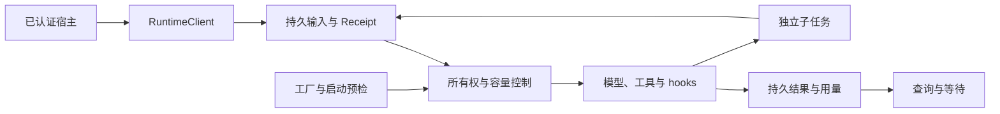

# Runtime 架构 · SDK 11

公开入口为 RuntimeClient。StatefulAgentLoop(runtime=runtime) 提供提交并等待的便捷调用。工厂在执行节点按不可变、版本化的描述符引用重建 ExecutionEnvironment；消息中不保存活的模型对象、资源连接或宿主密钥。

Store ID、会话目标、输入 ID 和任务代次分别标识不同对象。权限取自可信 actor，输入受理时固定配置和描述符。Worker 条件领取输入，取得会话所有权后装配环境。已受理与已执行完成是两个状态。

模型执行使用有界 Runtime 容量；工作流驱动和子任务共享入队与任务体系。等待不占唯一模型槽位。父任务中断后，健康子任务仍可查询；取消指向原任务与原资源。已经结束的工作流节点保存晚到子结果，显式继续时沿用原归属和累计额度。

默认组合使用内存传输、内存所有权和 store 启动独占锁，拒绝两个独立默认进程同时启动。纯 Client 不持有该锁。共享执行必须显式提供共享适配器，并在同能力 worker 组声明同一组 required_profiles。健康状态有界，不为每次请求额外查询健康数据库。

默认定时后端使用 SDK 存储和 Runtime 管理的 driver；显式宿主后端必须提供就绪 driver。定时器按索引分批扫描、条件领取，使用稳定输入 ID 提交，只等待受理。StoreBlackboard 在数据库内原子读改写，首次建行同样受保护。DeepTalk 适配器继续通过 API 管理业务状态。

未知外部动作只查询原结果或明确 unknown，不自动重放。恢复目标是格式正确、任务可见、流程可继续，不保证逐阶段精确恢复。当前结构可以重开，旧结构和协议直接拒绝，不保留兼容执行分支。

详见 [Runtime 契约](runtime-11.md)、[中文 API](zh/api/index.md) 和可执行编号示例。本文对应 SDK 11.0.0、任务结构 15、协议 42、描述符结构 1，不代表已经部署或启用。
