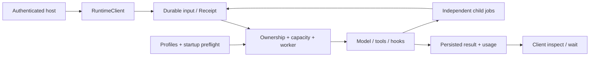

# Runtime architecture · SDK 11

The public entry is RuntimeClient. StatefulAgentLoop(runtime=runtime) is a submit-and-wait facade. A factory reconstructs ExecutionEnvironment on the worker using immutable versioned descriptor references. Live provider objects, resources and host credentials are never serialized into messages.

A store ID, session target, input ID and job generation identify different things. Authorization uses the trusted actor. Frozen request options and the descriptor travel with accepted input. Workers conditionally claim work and acquire session ownership before building its environment. Accepted input is distinct from completed execution.

Model work uses bounded Runtime capacity. Workflow drivers and child work use the same queue and job model. Waiting does not hold the sole model slot. Parent interruption leaves healthy children queryable; cancellation addresses the original task/resource. A finished workflow node retains late descendant results for explicit resume under its original owner and budget.

The default composition has memory transport and ownership plus a store startup lock. Multiple independent default processes are rejected; pure clients do not acquire the lock. Shared execution needs explicit shared adapters and homogeneous required profiles. Worker health records bounded port/driver status without a per-request health query.

The default timer backend uses store tables and a Runtime-owned driver. A host timer backend requires its own ready driver. Due timers are claimed in indexed batches and submitted with stable input IDs; the driver waits for acceptance only. StoreBlackboard performs database-atomic read/modify/write, including first creation. DeepTalk adapters keep business state behind its API.

Unknown external actions are queried or reported unknown, never automatically replayed. Recovery restores a valid, visible, continuable task; it does not promise exact recovery of every stage. Current stores reopen; old schema/protocol stores are rejected without a compatibility runtime.

See [runtime contract](../runtime-11.md), [stable API](api/index.md), and the source examples for executable composition and host requirements. This document describes SDK 11.0.0 / task schema 15 / protocol 42 / descriptor schema 1; it makes no deployment claim.
