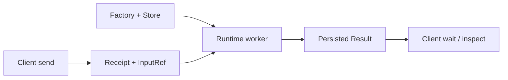

# Getting started with SDK 11

This checkout uses SDK 11.0.0, task schema 15, protocol 42 and descriptor schema 1. Install this source into an isolated environment; this delivery does not publish a package.

```bash
python3 -m venv .venv
.venv/bin/pip install -e '.[openai]'
.venv/bin/python examples/design203_single_process.py
```

The local example needs no model credentials or middleware. It creates a dedicated SQLite file, registers a factory, starts the worker, submits an input and waits for its result. Run it from a disposable test directory if you want to keep generated data separate. For live providers, install the provider extra, set POWER_LOOP_BASE_URL / POWER_LOOP_API_KEY / POWER_LOOP_MODEL and return the provider from the factory. Do not put secrets in RuntimeDescriptor.



[Quickstart](user-guide/quickstart.md) explains composition. [Sessions](user-guide/sessions.md) covers identity and retry. [API](api/index.md) lists public contracts. [Examples](../../examples/README.md) lists executable features and required host dependencies.
