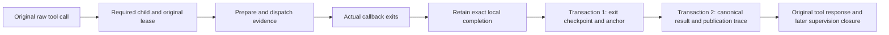

# Managed finite tool recovery (development)

This prototype is not connected to the default native host. The candidate task
protocol is 9; production activation, package publication and migrations are
separate gates. The supported resource is one finite callback with no detached
work or untracked paid requests. Other resource models need their actual
lifecycle interfaces and tests.

## Original execution and writes

`ManagedTool` implementations provide preparation, execution and query-only
recovery. The SDK binds the actual instance and schema through `RuntimeTool`;
tool names do not grant admission. The SDK handler declares
`background_allowed=False` and does not allow another background wrapper.



The completion contains the original execution lease, callback exit kind,
whether dispatch started, and the exact requested result. Exit evidence v2 and
its independent anchor are committed atomically. The anchor binds the original
creation, execution scope and completion hash. The original result is then
published in a second transaction, retaining a committed exit checkpoint if the
result write fails.

The SDK retains actual unsaved completions in a bounded, runtime-bound cache.
At most 1000 active or completed-but-unsaved entries are admitted; exhaustion
rejects a new call before registration, preparation or dispatch. It never drops
an unresolved entry to make room. Each completion document has the same 64 KiB
bound as the persisted checkpoint. An ordinary known result leaves no retained
entry after successful publication.

## Repair ports

- `flush_local(runtime, actor, job_id)` retries the exact SDK-held completion.
  It requires the same actual runtime authority and original execution. A new
  runtime cannot create a completion from an absent handle or remote lookup.
- `restore_result(manager, actor, job_id)` requires no runtime, provider or
  effect callback. In one transaction it validates the original call, creation,
  scope, lease, preparation, dispatch, exit and independent anchor, then publishes
  the original result and its trace. It does not claim a new generation.

Both public ports require trusted host context, outside a model/child execution
scope. Authorization is checked before reading the selected original job.
Concurrent repairs and commit-ACK loss recall the same result; conflicting,
missing, oversized, corrupt or wrong-generation evidence fails without guessing.

A successful response identifies the original job, generation and result event.
`owned_callback_exited=True` refers only to this supported finite callback.
`execution_authority`, `billing_settled`, `acknowledgement_created` and
`tool_receipt_written` remain false. Repair does not write or rewrite transcript
rows, dispatch an effect, call a model, grant a lease, acknowledge the outcome,
or finish its owner.

`ResultPublicationProof` is a generic, trusted SDK interface for publishing an
already-exited execution's result after its boot/lease expires. The managed
implementation rechecks the exact stored checkpoint and requested result in the
same transaction. It does not relax ordinary executor admission or ordinary
`record_execution_result` behavior. It cannot authorize new work, downstream
completion or billing settlement.

## Cancellation and shutdown

If cancellation precedes result publication, canonical result handling retains
the requested result while recording the effective cancelled outcome. A known
business result is preserved; cancellation cannot erase or resend the effect.

`TaskRuntime.shutdown` and `executor_status` both report
`managed_completion_pending`. Any retained unsaved completion forces
`store_safe_to_close=False`, including after a later status query. Once a repair
in another process succeeds, the original runtime still confirms its own exact
copy with `flush_local`; absence of activity alone is not confirmation.

## History and remaining obligations

Legacy exit evidence v1 remains readable without being rewritten. It has no
exact result checkpoint, so `restore_result` refuses to fabricate one. Protocol
upgrade requires explicit maintenance and retains the original store/message
identities. Old writers are rejected; opening a compatible store is not a
production migration policy.

If the process dies before any exit checkpoint is committed, its local cache is
lost. Remote business success or an expired lease does not prove the owned
callback's exit. That case still requires a trusted physical-stop/recovery
adapter. Claim-ACK loss before callback entry has the same need for independent
negative or physical evidence.

The original error tool row also does not acknowledge a later recovered success.
Repair leaves the result pending delivery unless an existing valid original ACK
already exists. Canonical processing responsibility, cancellation/inspection
integration and formal business-host wiring remain separate unfinished parts of
the overall async lifecycle work. Default native entry stays disabled.

## Pending calls after an actual model exit (development protocol 11)

A finite callback's exit checkpoint does not prove its enclosing model executor
has exited. `close_model_execution` remains the trusted host exit port: the SDK
calls it when its actual send unwinds; an external process owner may use it only
after observing the exact original process exit. A lease expiry, missing PID or
successful business lookup is insufficient. Original model-attempt evidence must
also rule out an unfinished or unknown provider request. This is separate from
final accounting.

When the source still has pending calls, that port captures a reserved
`pending_call_snapshot` in the same transaction as the model exit. It contains
the original execution scope, assistant MessageRef and exact pending document.
Call IDs, original arguments, send index and the completeness of the unresolved
set are checked against original messages. Invalid evidence leaves an explicit
snapshot error and an unknown resource state; it cannot silently become stopped.
Callers cannot supply these reserved fields themselves.

After the original model exit is confirmed, the host may call:

```python
from power_loop.runtime.pending_calls import retire_pending

receipt = await retire_pending(loop, original_main_actor, original_send_job_id)
```

This port currently handles the original main send. It requires every captured
pending call to have its original managed-tool registration, actual finite exit,
known result and validated notification to that original main. It atomically
stores a `pending_call_disposition` retaining the original pending document and
clears only that exact pending state. It writes no tool reply, starts no model or
business callback, grants no execution authority and creates no processing ACK.
Unknown outcomes, missing evidence, interactive calls and unsupported or partly
registered pending sets remain blocked. Workflow/subagent pending calls require
their explicit owner recovery adapter; this port never promotes one to main.

A commit with a lost ACK can be recalled using the same original identity.
Concurrent connections recall one disposition; replay cannot clear a newer send's
pending calls. Processing snapshots and retained supervision proofs include and
revalidate the disposition. Deleting it, rewriting it or changing its original
call evidence cannot leave an apparently valid closed parent.

The original result stays `pending_delivery` after retirement. Only an actual,
visible original-main notification followed by its persisted response and clean
model exit can mark it handled. A hidden notice, failed model call or exhausted
budget leaves it unhandled. The reviewing send uses the original frozen budget
policy and its remaining authority; recovery cannot replace that policy or add
quota. Its original raw history may contain a genuinely missing tool reply: use
an appropriate representation, such as the SDK projected representation, rather
than manufacturing an original response.

A later cancellation preserves an already closed model phase and records the
cancellation request independently. It must not turn that phase back into a
running cancellation and strand its pending/result responsibility.

Bounds: 32 KiB pending document, 64 pending calls, the existing 128 KiB original
assistant tool-call bound, 4 MiB model-exit record and 256 KiB disposition. Exceeding
a bound refuses recovery without truncating or discarding obligations.

This is a component candidate, not default host activation. It does not complete
a restart supervisor, arbitrary pending-tool recovery, workflow owner recovery,
business API integration or final fee reconciliation. Production maintenance is
explicit; protocol 11 prevents older writers from ignoring the new obligations.
