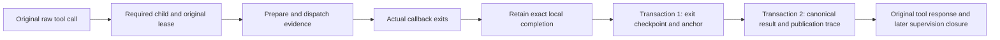

# Managed finite tool recovery (development)

This prototype is not connected to the default native host. The candidate task
protocol is 13; production activation, package publication and migrations are
separate gates. The supported resource is one finite callback with no detached
work or untracked paid requests. Other resource models need their actual
lifecycle interfaces and tests.

## Original execution and writes

`ManagedTool` implementations provide preparation, execution and query-only
recovery. The SDK binds the actual instance and schema through `RuntimeTool`;
tool names do not grant admission. The SDK handler declares
`background_allowed=False` and does not allow another background wrapper.



The completion contains the original execution lease, callback exit kind,
whether dispatch started, and the exact requested result. Exit evidence v2 and
its independent anchor are committed atomically. The anchor binds the original
creation, execution scope and completion hash. The original result is then
published in a second transaction, retaining a committed exit checkpoint if the
result write fails.

The SDK retains actual unsaved completions in a bounded, runtime-bound cache.
At most 1000 active or completed-but-unsaved entries are admitted; exhaustion
rejects a new call before claiming, preparation or dispatch. A pre-registered
batch intention is retained until its independently verified negative closure. It never drops
an unresolved entry to make room. Each completion document has the same 64 KiB
bound as the persisted checkpoint. An ordinary known result leaves no retained
entry after successful publication.

## Repair ports

- `flush_local(runtime, actor, job_id)` retries the exact SDK-held completion.
  It requires the same actual runtime authority and original execution. A new
  runtime cannot create a completion from an absent handle or remote lookup.
- `restore_result(manager, actor, job_id)` requires no runtime, provider or
  effect callback. In one transaction it validates the original call, creation,
  scope, lease, preparation, dispatch, exit and independent anchor, then publishes
  the original result and its trace. It does not claim a new generation.

Both public ports require trusted host context, outside a model/child execution
scope. Authorization is checked before reading the selected original job.
Concurrent repairs and commit-ACK loss recall the same result; conflicting,
missing, oversized, corrupt or wrong-generation evidence fails without guessing.

A successful response identifies the original job, generation and result event.
`owned_callback_exited=True` refers only to this supported finite callback.
`execution_authority`, `billing_settled`, `acknowledgement_created` and
`tool_receipt_written` remain false. Repair does not write or rewrite transcript
rows, dispatch an effect, call a model, grant a lease, acknowledge the outcome,
or finish its owner.

`ResultPublicationProof` is a generic, trusted SDK interface for publishing an
already-exited execution's result after its boot/lease expires. The managed
implementation rechecks the exact stored checkpoint and requested result in the
same transaction. It does not relax ordinary executor admission or ordinary
`record_execution_result` behavior. It cannot authorize new work, downstream
completion or billing settlement.

## Cancellation and shutdown

If cancellation precedes result publication, canonical result handling retains
the requested result while recording the effective cancelled outcome. A known
business result is preserved; cancellation cannot erase or resend the effect.

`TaskRuntime.shutdown` and `executor_status` both report
`managed_completion_pending`. Any retained unsaved completion forces
`store_safe_to_close=False`, including after a later status query. Once a repair
in another process succeeds, the original runtime still confirms its own exact
copy with `flush_local`; absence of activity alone is not confirmation.

## History and remaining obligations

Legacy exit evidence v1 remains readable without being rewritten. It has no
exact result checkpoint, so `restore_result` refuses to fabricate one. Protocol
upgrade requires explicit maintenance and retains the original store/message
identities. Old writers are rejected; opening a compatible store is not a
production migration policy.

If the process dies before any exit checkpoint is committed, its local cache is
lost. Remote business success or an expired lease does not prove the owned
callback's exit. That case still requires a trusted physical-stop/recovery
adapter. Claim-ACK loss before callback entry has the same need for independent
negative or physical evidence.

The original error tool row also does not acknowledge a later recovered success.
Repair leaves the result pending delivery unless an existing valid original ACK
already exists. Canonical processing responsibility, cancellation/inspection
integration and formal business-host wiring remain separate unfinished parts of
the overall async lifecycle work. Default native entry stays disabled.

## Pending calls after an actual model exit (development protocol 11)

A finite callback's exit checkpoint does not prove its enclosing model executor
has exited. `close_model_execution` remains the trusted host exit port: the SDK
calls it when its actual send unwinds; an external process owner may use it only
after observing the exact original process exit. A lease expiry, missing PID or
successful business lookup is insufficient. Original model-attempt evidence must
also rule out an unfinished or unknown provider request. This is separate from
final accounting.

When the source still has pending calls, that port captures a reserved
`pending_call_snapshot` in the same transaction as the model exit. It contains
the original execution scope, assistant MessageRef and exact pending document.
Call IDs, original arguments, send index and the completeness of the unresolved
set are checked against original messages. Invalid evidence leaves an explicit
snapshot error and an unknown resource state; it cannot silently become stopped.
Callers cannot supply these reserved fields themselves.

After the original model exit is confirmed, the host may call:

```python
from power_loop.runtime.pending_calls import retire_pending

receipt = await retire_pending(loop, original_main_actor, original_send_job_id)
```

This port currently handles the original main send. It requires every captured
pending call to have its original managed-tool registration, actual finite exit,
known result and validated notification to that original main. It atomically
stores a `pending_call_disposition` retaining the original pending document and
clears only that exact pending state. It writes no tool reply, starts no model or
business callback, grants no execution authority and creates no processing ACK.
Unknown outcomes, missing evidence, interactive calls and unsupported or partly
registered pending sets remain blocked. Workflow/subagent pending calls require
their explicit owner recovery adapter; this port never promotes one to main.

A commit with a lost ACK can be recalled using the same original identity.
Concurrent connections recall one disposition; replay cannot clear a newer send's
pending calls. Processing snapshots and retained supervision proofs include and
revalidate the disposition. Deleting it, rewriting it or changing its original
call evidence cannot leave an apparently valid closed parent.

The original result stays `pending_delivery` after retirement. Only an actual,
visible original-main notification followed by its persisted response and clean
model exit can mark it handled. A hidden notice, failed model call or exhausted
budget leaves it unhandled. The reviewing send uses the original frozen budget
policy and its remaining authority; recovery cannot replace that policy or add
quota. Its original raw history may contain a genuinely missing tool reply: use
an appropriate representation, such as the SDK projected representation, rather
than manufacturing an original response.

A later cancellation preserves an already closed model phase and records the
cancellation request independently. It must not turn that phase back into a
running cancellation and strand its pending/result responsibility.

Bounds: 32 KiB pending document, 64 pending calls, the existing 128 KiB original
assistant tool-call bound, 4 MiB model-exit record and 256 KiB disposition. Exceeding
a bound refuses recovery without truncating or discarding obligations.

This is a component candidate, not default host activation. It does not complete
a restart supervisor, arbitrary pending-tool recovery, workflow owner recovery,
business API integration or final fee reconciliation. Production maintenance is
explicit; protocol 11 prevents older writers from ignoring the new obligations.

## Whole original call batches (development protocol 12)

Before any native tool callback, the SDK retains the complete original ordered
assistant call set, its actual registrations, schema, runtime contracts and
argument hashes. Eligible `RuntimeTool.pending_call_spec` implementations describe
managed finite effects. The SDK atomically registers their generation-zero
intentions together with a bounded plan and independent seal. The method is a
pure description, not an execution or recovery callback. Plain or missing tools
remain explicit unsupported entries; their absence never proves non-dispatch.

The assistant message and its pending marker are committed in one store
transaction for an actual native send. Plan persistence follows that original
write. If a later sink hook, plan write, registration, commit or commit ACK fails,
no callback can run without the complete acknowledged plan. Original raw/pending
responsibility remains visible. A durable plan alone cannot authorize execution:
the same send must retain its actual process-local `RegisteredTool` objects.
Replacement with the same schema/contract, re-registering the same handler, or
reopening in another process does not transfer that authority. Dispatch checks
the original binding after admission waits and hooks.

Generation-zero intention registration is not a resource start. A capacity or
admission error may therefore leave an intention without claiming it. After the
actual raw error receipt is bound, the SDK atomically closes a proven never-claimed
intention as `not_dispatched`; no prepare/execute/recover, callback-exit proof,
success receipt or processing ACK is invented. Compact SDK error codes retain
their bounded error view even when the success-result capacity is insufficient.
Generic consumers still use the registered implementation's `format_result`.

After a trusted actual original-main model exit, the host may call:

```python
from power_loop.runtime.tool_call_plans import reconcile_pending
from power_loop.runtime.pending_calls import retire_pending

await reconcile_pending(loop, original_main_actor, original_send_job_id)
await retire_pending(loop, original_main_actor, original_send_job_id)
```

Reconciliation first validates the entire captured pending set and sealed plan.
Every member must have either an exact never-claimed proof or an actual exited
finite execution with a known canonical result. Only then are generation-zero
negatives closed and original-main notifications staged. These operations are
idempotent but are not a single transaction across all notices; a later failure
retains earlier durable records for exact replay. Unsupported members, missing
plans, unknown execution/outcomes and workflow/subagent owners remain blocked.
No callback or model is invoked and no missing `role=tool` row is manufactured.
Retirement keeps the exact original pending disposition. Neither port grants new
quota, claims a generation or acknowledges processing.

A generation-zero negative permanently retains canonical `suppressed` status and
its independent supervision-close proof. When its raw reply was lost, its
original source still needs an actual main review before source closure. Query
results expose this separate read-only `processing_obligation`: `not_required`,
`pending`, `handled` or `unknown`, with original notice/decision/response pointers.
Physically closed negatives are not permanent active zombies; a pending or
corrupt review is still active. Querying never acknowledges a result. Only the
actual original main's visible notice, persisted response and clean model exit
can satisfy that obligation, under the original remaining budget. Coalesced
notices retain exact raw-message validation; hiding one part cannot acknowledge
the modified message's other part.

The plan is limited to 64 calls and 256 KiB, with existing original-call and
pending bounds unchanged. Explicit maintenance upgrades protocols through 11 to
12 without rewriting original IDs; default SDK/host activation is a separate
step. Recovery for unsupported/missing plans, claimed-before-preparation crashes
and child-owner pending batches still needs its own supported evidence/adapter.
This candidate is not an activation or completion of the overall async project.

A wholly control-only batch uses the same original-source control gate as each
actual registered implementation. It may inspect or request a stop after lease
expiry, while retaining exact original message, scope and binding checks. It
registers no managed effect and grants no new model request. A plain same-named
handler, a batch containing a new effect, or a recovery description that would
register an effect still requires the ordinary execution fence. This rule is
classified by `ToolDispatchPolicy.control_only`, never by catalog names.

## Positive pre-admission aborts (development protocol 13)

A missing or rolled-back plan alone cannot prove non-execution. The actual SDK
preparation stack can record a separate abort checkpoint only after freezing the
complete original declarations and before installing any batch dispatch grant.
It retains the original scope, assistant MessageRef, declarations and observed
plan reference, with an independent anchor committed in the same transaction.
Existing dispatch, claim, actual scope, malformed or mismatched original evidence
rejects the checkpoint. An admitted batch cannot be reclassified this way.

This evidence is generated by the actual original failure path, not model
arguments or a new registry/process. Both an existing acknowledged plan and an
absent plan remain distinct. The SDK refuses later claims or dispatches under
that checkpoint. If saving the checkpoint fails or cancellation interrupts it,
no absence-based fallback is used: the original pending remains unknown. The
original preparation failure is preserved and checkpoint unavailability logged
without its potentially sensitive error text. Commit-ACK loss recalls the same
saved checkpoint. No host prepare/execute/recover or extra model call is made.

Actual model exit can capture a version3 pending snapshot referencing this
checkpoint. A process owner must still wait/reap its exact original process
before recording that exit. This preserves the separate facts of physical
model exit and unresolved original call responsibility. A lease expiry, missing
PID or this checkpoint by itself never proves model exit or billing settlement.

`tool_call_abort.read_abort(manager, actor, source_job_id, assistant_seq=...)` is
a host-only, authorized original-evidence reader. It does not need a runtime,
provider or registered tool. It rechecks the anchor, original message, complete
call set, source protocol and observed plan/intent/dispatch state without
writing history or acknowledgement. A fresh process cannot recreate a checkpoint.

The checkpoint does not retire pending calls or supply missing negative results.
Unsupported/missing-plan outcome notification and actual original-owner handling
still need their explicit next protocol. The source cannot complete merely
because its model is known to have exited. Crashing before any checkpoint is
saved, incomplete/oversized declarations and lost evidence stay unknown. Protocol
upgrade requires explicit maintenance; default protocol6 remains unchanged.

## Original-main aborted-batch outcomes (candidate protocol 14)

`tool_call_plans.reconcile_pending(loop, actor, source_job_id)` now has an explicit
route for a verified version3 pre-admission abort from the actual original main.
It requires the original complete pending set, positive checkpoint and anchor,
actual stopped model and untouched original assistant call. It rejects any later
real tool reply for this batch. Missing evidence remains unknown. It never
creates an intention or resource for an action that was never registered.

One control transaction closes any real never-claimed generation0 intentions,
publishes a negative `aborted_call_batch` result on the original source send,
queues its original-main notice, records its pending disposition and clears only
that exact pending. An already-stopped send stays `model_closed`. A publication
proof may publish only its negative, stopped result; it cannot regress physical
state or authorize a success. Mechanical reconciliation preserves the original
model-attempt and budget ledgers. Its usage reference does not claim zero fees,
acknowledgement or billing settlement.

A lost commit acknowledgement recalls the same result, notice and disposition.
Existing protocol13 per-item managed notices/dispositions keep their original
route and decisions. Previously completed generation0 negatives remain
`suppressed`; the batch source has its own `pending_delivery`/`handled` result.
A reused provider call ID cannot attach an earlier call's intention to a later
assistant message: the original MessageRef is part of the match.

Retiring pending or delivering a notice is not processing. Actual original-main
model input must contain the exact original delivered message, then preserve the
real response and a clean exit before the source can close supervision. Hidden
or modified notices, failed models and exhausted original quota leave the
responsibility open. `jobs` reports the separate processing obligation without
acknowledging it. Lost notice/result/disposition evidence blocks new work;
discovery does not rely on the notification projection alone. It selects explicit
SDK abort/result/notice/disposition hints before loading bounded evidence; an
unrelated ordinary send result, including a large one, is not an abort review.

During this review the SDK appends English constraints and offers only pure
`RuntimeTool.review_spec(spec)` views provided by actual registered implementations
(default `None`). `FunctionRuntimeTool` accepts an optional `reviewer` callback.
SDK jobs, recall and workflow implement their own control views, including aliases
and explicit wrappers. A view is never execution permission: actual
`ToolDispatchPolicy.control_only` is rechecked before registering batch intentions,
before dispatch and before registering any new resource under the main send.
Original frozen model quota still applies. Already-admitted descendants retain
their own existing execution and supervision duties.

Presentation follows the same principle. Subagent completion captures the actual
original registered definition/context override, rather than a fixed catalog
name. A producer may mark a user message with `meta.context_timeline=true` for
chronological projection. Neither field grants execution authority. The exported
legacy `validate_tool_args(str, args)` catalog shorthand remains a compatibility
helper, not a runtime registry check; pass an actual `ToolDefinition`, or use the
actual `ToolRegistry.validate`, for custom/renamed tools.

Explicit maintenance upgrades protocol13 to14 without rewriting original IDs or
records. Child-owner pending batches, pre-checkpoint crashes and claimed-before-
preparation resource exit still require their own protocols. Default SDK/host
activation and final rollout are separate gates; this candidate does not enable
them automatically.

## Original child owner: retained-controller path (protocol 15 candidate)

New native `workflow_node` and standalone `subagent` owners opt in through their
original creation request and an immutable first-claim admission checkpoint.
Each original child send freezes its actual per-call round limit; a larger
current configuration cannot add review credit. Admission, original scopes,
member relationship, physical session role and node-session provenance are
revalidated together. Legacy owners retain their existing protocol.

The initial `run_agent_spec` path can process a v3 pre-admission abort while its
original SDK controller is still retained. Pure historical readers and host-only
negative-result publication do not grant model permission. The review helper
requires the actual original owner object, local execution binding and current
asyncio task, an unsealed original member set, current lease, original deadline
and remaining completion/model-budget credit. A newly constructed binding or a
copied context in another task cannot replace this controller.

Negative result publication, genuine generation-zero closure, original-child
notice and exact pending disposition commit atomically. The notice identifies
`review_session_id` and the original owner, without promoting the child to main.
The helper offers no business tools, preserves original calls as projected data,
and does not fabricate missing tool replies. Only actual notice visibility,
response and clean model exit can acknowledge processing. Successful processing
returns a **failed original task result** with actual usage, not a successful
business deliverable. A workflow may continue past that failed node only through
its existing explicit `continue_on_error` policy and after processing completes.

Quota exhaustion, cancellation, hidden notice, corrupt evidence and expired or
replaced ownership leave the original obligation unresolved. An owner cannot
publish its result while such captured pending calls or their review remain
unresolved. Normal cancellation without pending calls remains supported. If a
cancellation leaves a prepared but unexecuted v2 pending call, it must remain
pending; a cancellation token alone does not justify disposal or a premature
child completion notice.

This candidate does **not** implement cross-process owner restoration, the
`continue_agent` exception path, or general v2 executed/known-result recovery.
Old generations whose members are sealed cannot receive new model sends. Those
paths need their own transition and physical-exit proof; neither a relaxed
pending guard nor main-role promotion is an acceptable shortcut. Protocol 15
requires explicit maintenance; the default host/runtime is not activated by
these candidate changes.
