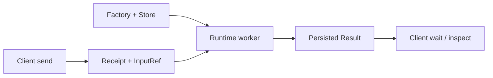

# SDK 11 入门

本源码使用 SDK 11.0.0、任务结构 15、协议 42、描述符结构 1。在隔离环境中安装本地源码；本次交付不发布包。

```bash
python3 -m venv .venv
.venv/bin/pip install -e '.[openai]'
.venv/bin/python examples/design203_single_process.py
```

本地示例不需要模型密钥或中间件。它创建专用 SQLite 文件、注册工厂、启动 worker、提交输入并等待结果。需要隔离生成数据时，在临时测试目录运行该脚本的绝对路径。使用真实模型时安装对应 provider extra，配置 POWER_LOOP_BASE_URL / POWER_LOOP_API_KEY / POWER_LOOP_MODEL，并从工厂返回 provider。密钥不能放入 RuntimeDescriptor。



[快速开始](user-guide/quickstart.md) 说明装配，[会话](user-guide/sessions.md) 说明身份和重试，[API](api/index.md) 列出公开契约，[示例](../../examples/README.md) 列出可执行能力与宿主依赖。
