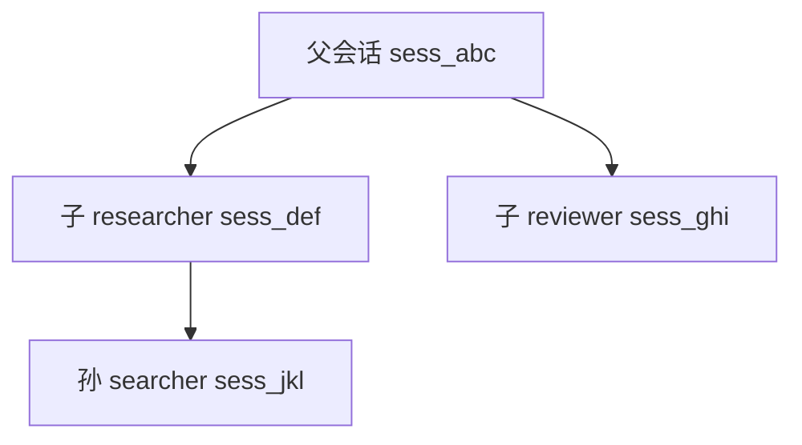

# 子代理

[English](../../en/user-guide/subagents.md) | [用户手册](../index.md)

子代理让父 Agent 将任务委托给专门的子 Agent。8.0 起模型侧 `spawn_agent` 始终异步，`action=create` 创建、`action=nudge` 在原有子会话续跑或插话；宿主同步机制 `run_agent_spec` 仍保留。每个子代理拥有独立的 `StatefulAgentLoop` 和自定义 system prompt、工具白名单。

## 两种路径

| 路径 | 触发方式 | 控制程度 |
|---|---|---|
| **LLM 侧** (`spawn_agent`) | LLM 调用 `spawn_agent` 工具（可选覆盖 `system_prompt` / `tools` / `max_rounds`） | LLM 决定委托什么 |
| **声明式** (`run_agent_spec` / `AgentSpec`) | 宿主代码直接调用 Python API | 你控制 system prompt、工具、model、max_rounds |

> 4.0 起原 `run_agent` meta-tool 已并入 `spawn_agent`：LLM 侧只有 `spawn_agent` 一个 meta-tool；需要完整声明式 `AgentSpec` 的场景由宿主代码调 `run_agent_spec()`。

## 命令式：spawn_agent

```python
from power_loop import register_spawn_agent

register_spawn_agent(registry)

loop = StatefulAgentLoop(
    llm=llm,
    tool_registry=registry,
    config=AgentLoopConfig(
        system_prompt=(
            "你可以用 spawn_agent 委托研究任务。"
            "用 tools 白名单限定子代理的能力集。"
        ),
        max_rounds=6,
    ),
)

sid = await loop.new_session()
result = await loop.send("找到项目中的认证逻辑代码。", session_id=sid)
# LLM: spawn_agent(task="搜索认证代码", tools=["grep", "read_file", "glob"])
# → 立即返回 session_id/run_id 接收回执；子代理完成后结果进入父的 task_done 收件箱。
# 空闲父会话的自动唤醒由宿主接线；通用库只持久入箱，不擅自驱动宿主会话。
```

### 结构化结果：`output_schema`

主代理要的是数据而不是一段话时，可以传 `output_schema`：`{"name"?, "schema", "strict"?}`、裸 JSON Schema，
或二者的 JSON 字符串。根必须是 `{"type": "object", ...}`。

- schema 作为 `AgentSpec.output_schema` 交给子代理：模型声明了 `supports_json_schema` 就走原生
  `response_format: json_schema`，否则写进那一次请求的 system prompt。
- 这里 `strict` 默认 **false**：LLM 自己写的 schema 很少符合 strict 规范（每层所有键必填、禁止多余字段），
  原生服务端遇到会直接 400。确实符合规范的 schema 可以写 `"strict": true`。
- 子代理完成结果为结构化信封，包含 `final_text`、状态、`usage`、本次 `messages`/`projection` 范围；成功的结构化数据在 `payload` 中，失败附原因。默认 linked 保留子会话，修复和续跑使用同一上下文。
- `spawn_agent(action="nudge", sub_session="sess_...", message="补充指令")` 始终异步；运行中是插话，空闲时是新 run，保留原角色、工具和输出约束。
- `recall_send(sub_session="sess_...", source="messages", seq=37)` 可直接查子消息；`source="projection", ids=[lo,hi]` 查投影。默认 20 条、总字符预算 8000，继续读取按返回的游标。
- `output_file="records/child.jsonl"` 将选中完整已存记录导出到新文件，不覆盖，不再向上下文返回正文；省略字符分页参数。
- 新建投影表有自增 ID；不迁移旧数据。旧结构只能继续渲染，按 ID 查询明确报告不可用。

## 声明式：AgentSpec

```python
from power_loop import AgentSpec, run_agent_spec

spec = AgentSpec(
    name="researcher",
    system_prompt="你是代码研究员。使用 grep、read 和 glob 查找答案。",
    tools=["grep", "read", "glob"],  # 白名单——只有这些工具
    max_rounds=5,
    max_tokens=2000,
    temperature=0.0,
    lifecycle="ephemeral",           # 成功删除，失败保留供调试
)

result = await run_agent_spec(spec, "查找所有 SQL 注入漏洞", parent_loop=loop)
```

`AgentSpec.output_schema`（`{name, schema, strict?}`）要求子代理交回一个 JSON 对象；`strict` 默认 `true`，
schema 不符合 strict 规范时写 `false`。辅助函数：`normalize_output_schema()`、`output_response_format()`。
workflow 的 agent 节点 `output_schema` 同样可以带 `strict`。

### AgentSpec 校验

`AgentSpec` 有**严格校验**。未知字段、非法 lifecycle 值或越界的 `max_rounds` 抛出 `AgentSpecError`（`SpecValidationError` → `PowerLoopError`）。

## 生命周期

| 生命周期 | 行为 |
|---|---|
| `EPHEMERAL`（默认） | 成功时删除。失败时保留供调试。 |
| `LINKED` | 父会话关闭时级联删除。 |
| `DETACHED` | 独立于父会话。父关闭后继续存在。 |

## 深度限制

`MAX_SPAWN_DEPTH = 3` 是默认值 —— 子代理在 root 之下最多嵌套这么多层（depth 1、2、3 允许，depth 4 会报错）。在 `SessionStore.create_session()` 强制执行。可按 store 配置：`SessionStore.open(max_spawn_depth=N)` 或 `StatefulAgentLoop(..., max_spawn_depth=N)`。

## 会话树



所有子代理共享父代理的 `SessionStore`。`close_session(parent_sid, cascade=True)` 递归删除整棵树。

## 下一步

- [Hooks](hooks.md) — 拦截工具执行
- [压缩](compaction.md) — 自动摘要长会话
